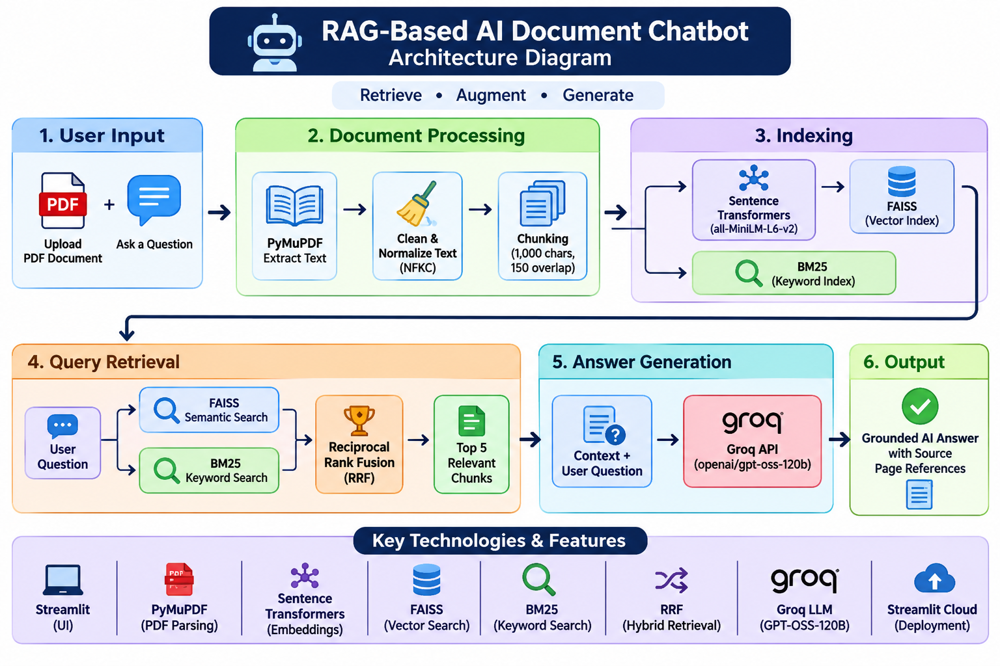

# RAG-Based AI Document Chatbot

A Retrieval-Augmented Generation (RAG) application that allows users to upload PDF documents and ask questions based on their content. The application uses hybrid retrieval to find relevant information and generates context-grounded answers with source page references.

## Live Demo

[Try the RAG-Based AI Document Chatbot](https://rag-based-ai-document-chatbot-nn9grzn8ckqkgdzinyez3o.streamlit.app/)

## Architecture Diagram



## Features

- Upload and extract text from PDF documents.
- Text cleaning, normalization, and overlapping chunking.
- Generate text embeddings using Sentence Transformers.
- Semantic search using FAISS.
- Keyword-based retrieval using BM25.
- Hybrid retrieval using Reciprocal Rank Fusion (RRF).
- Generate context-grounded answers using Groq API.
- Display retrieved context and source page references.
- Chat history and clear chat history functionality.
- Fallback response when the document does not contain the requested information.

## Technologies Used

- **Programming Language:** Python
- **Frontend:** Streamlit
- **PDF Processing:** PyMuPDF
- **Embeddings:** Sentence Transformers (`all-MiniLM-L6-v2`)
- **Vector Search:** FAISS
- **Keyword Search:** BM25
- **Hybrid Retrieval:** Reciprocal Rank Fusion (RRF)
- **LLM API:** Groq API
- **LLM Model:** `openai/gpt-oss-120b`
- **Deployment:** Streamlit Community Cloud

## System Workflow

1. User uploads a PDF document.
2. PyMuPDF extracts text from the PDF.
3. Text is cleaned, normalized, and divided into overlapping chunks.
4. Sentence Transformers converts text chunks into embeddings.
5. FAISS performs semantic similarity search.
6. BM25 performs keyword-based retrieval.
7. Reciprocal Rank Fusion combines both retrieval rankings.
8. The top 5 relevant chunks are selected.
9. Retrieved context and the user question are sent to the Groq API.
10. The generated answer and source page references are displayed in Streamlit.

## Installation and Setup

### 1. Clone the repository

```bash
git clone https://github.com/jayasimha468/RAG-Based-AI-Document-Chatbot.git
cd RAG-Based-AI-Document-Chatbot
```

### 2. Install dependencies

```bash
pip install -r requirements.txt
```

### 3. Configure Groq API Key

Create a `.streamlit/secrets.toml` file and add:

```toml
GROQ_API_KEY = "your_groq_api_key"
```

Replace the placeholder with your actual Groq API key. Never commit this file to GitHub.

### 4. Run the application

```bash
python -m streamlit run app.py
```

## Testing

- Tested using a 190-page PDF document containing 578 text chunks.
- Verified document-based question answering.
- Tested behavior when the requested information was not available in the uploaded document.
- Verified source page references in generated answers.

## Future Improvements

- Support multiple document formats.
- Improve retrieval relevance and ranking.
- Implement systematic retrieval and answer evaluation metrics.
- Add support for multiple PDF documents.
- Improve user interface and document management.

## Author

Jai

## Project Links

- **Live Application:** https://rag-based-ai-document-chatbot-nn9grzn8ckqkgdzinyez3o.streamlit.app/
- **GitHub Repository:** https://github.com/jayasimha468/RAG-Based-AI-Document-Chatbot
